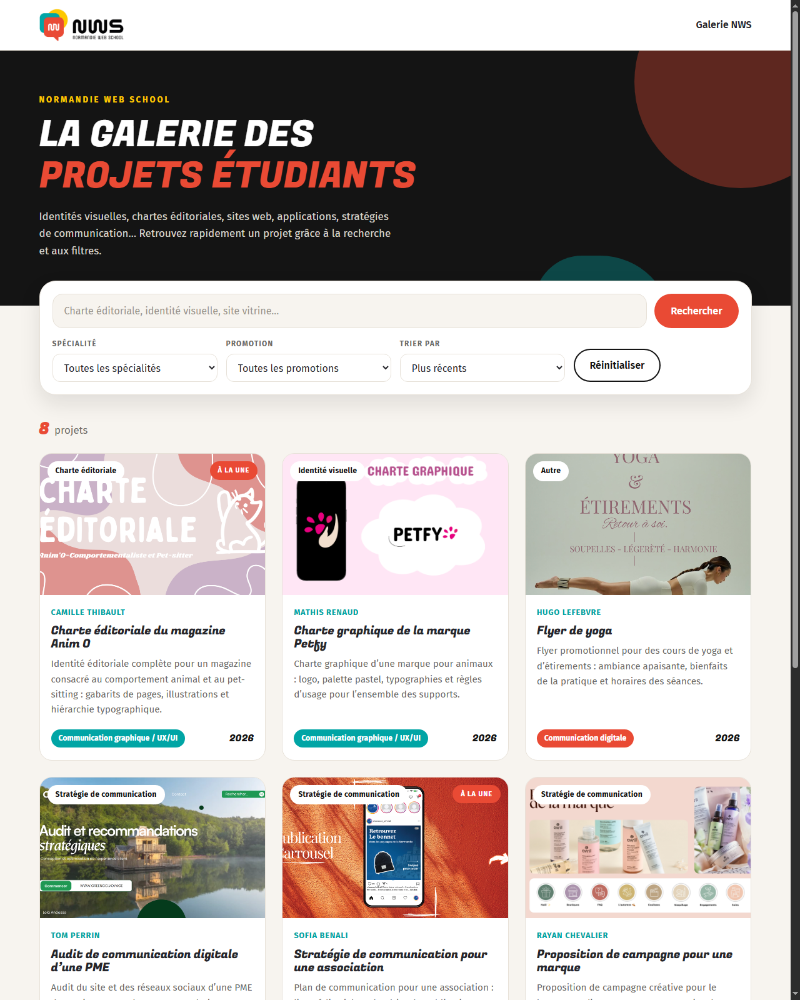
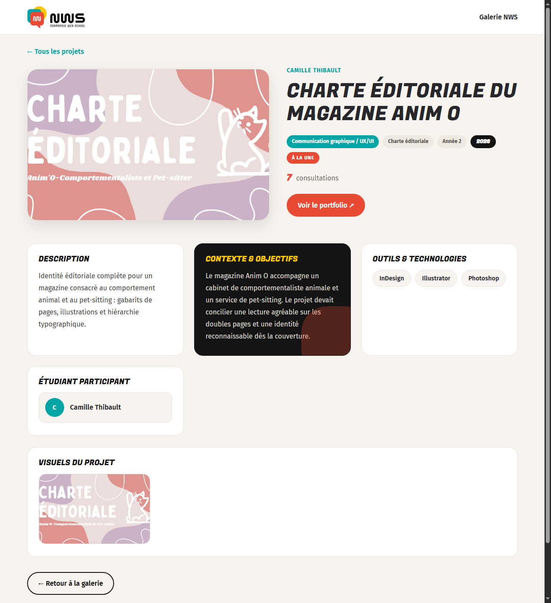
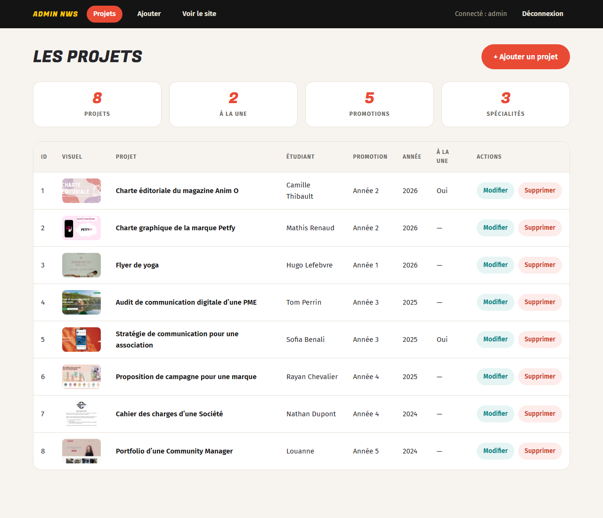

# Galerie des projets — version pédagogique

Version **simplifiée** du projet FAP *Galerie des projets étudiants NWS* : le même rendu
visuel que le site complet, mais **sans base de données ni espace d'administration** —
les projets sont directement écrits dans un fichier PHP. Idéal pour apprendre à
découper une page en plusieurs fichiers, afficher une liste, filtrer et créer une
page de détail.



---

## Fonctionnalités

### Page d'accueil (`index.php`)

- **8 cartes projet** : image de couverture, titre, étudiant, année, spécialité, type de livrable.
- **Recherche** par mots-clés (titre, description, étudiant, type).
- **Listes déroulantes** : spécialité et promotion (générées automatiquement
  à partir des données), **tri** plus récents / A→Z / année (ancien d'abord).
- Message « aucun résultat » + bouton *Réinitialiser*.
- Badge **« À la une »** sur les projets mis en avant.
- Cartes **cliquables** : un clic ouvre la fiche du projet.

### Fiche détaillée (`projet.php`)

- Fil d'ariane, image, titre, pastilles (spécialité, type, promotion, année, à la une).
- Description, **contexte & objectifs**, **outils & technologies**, étudiant participant.
- **Lien portfolio / GitHub** affiché automatiquement quand le projet en a un.
- **Compteur de consultations** (stocké dans `vues.json`).
- **Visionneuse** plein écran au clic sur le visuel.
- Page **404** propre si le projet demandé n'existe pas.
- Bouton *Retour à la galerie*.



### Administration (`/admin`)

- Connexion sécurisée : sessions, mot de passe en **bcrypt**, limitation des tentatives.
- **Protection CSRF** sur tous les formulaires.
- Tableau de bord : statistiques + liste des projets.
- Ajout, modification et **suppression** de projets (avec confirmation).
- **Upload d'images** : contrôle du format (jpg, png, webp, gif) et de la taille (5 Mo max),
  nommage automatique, suppression de l'ancien fichier s'il n'est plus utilisé.
- Les projets sont enregistrés dans `donnees.php` — le site public n'a pas besoin de base de données.



---

## Pile technique

| Couche | Technologie |
| --- | --- |
| Back-end | PHP 8 (données en tableau PHP, **sans base de données**), sessions, CSRF |
| Front-end | HTML5, CSS3, JavaScript vanilla (aucun framework) |
| Polices | Google Fonts — *Fugaz One* (titres) et *Fira Sans* (textes) |

Direction artistique : charte graphique **Normandie Web School**
(orange `#e94a34`, turquoise `#00a5a5`, jaune `#fec800`).

---

## Installation (XAMPP)

1. **Copier le dossier du projet** dans le dossier web d'Apache :

   ```bash
   xcopy "C:\Users\babae\Documents\NWS\galérie des projets" "C:\xampp\htdocs\galerie-des-projets" /E /I
   ```

2. **Démarrer Apache** (panneau de contrôle XAMPP → *Start* devant Apache ;
   MySQL n'est pas nécessaire).

3. Ouvrir **<http://localhost/galerie-des-projets/>**.
4. Administration : **<http://localhost/galerie-des-projets/admin/>**.

> Aucune base de données à importer : le site fonctionne dès la copie.

### Compte d'administration de démonstration

| Champ | Valeur |
| --- | --- |
| Pseudo | `admin` |
| Mot de passe | `admin123` |

---

## Modifier les projets

Deux façons de faire : **l'administration** (interface web, recommandée) ou
l'édition directe de **`donnees.php`**.

### Via l'administration (recommandé)

1. Se connecter sur <http://localhost/galerie-des-projets/admin/> (`admin` / `admin123`).
2. **+ Ajouter un projet** ou **Modifier** / **Supprimer** depuis la liste.
3. L'admin réécrit automatiquement `donnees.php` (au format export PHP, normal).

### En éditant `donnees.php` à la main

Chaque projet est un bloc de la forme :

```php
[
    'id'          => 9,
    'titre'       => 'Titre du projet',
    'etudiant'    => 'Prénom Nom',
    'annee'       => 2026,
    'promotion'   => 'Année 1',
    'specialite'  => 'Développement web',
    'type'        => 'Site web',
    'image'       => 'img/mon-image.png',
    'enAvant'     => true,
    'description' => 'Courte description affichée sur la carte.',
    'contexte'    => 'Contexte et objectifs détaillés, affichés sur la fiche.',
    'outils'      => ['HTML', 'CSS', 'JavaScript'],
    'lien'        => ['type' => 'github', 'url' => 'https://github.com/…'],
],
```

- **Ajouter un projet** : copier un bloc, coller-le avant le `];`, changer l'`id`
  (un nombre unique) et l'image dans le dossier `img/`.
- **Aucun lien** sur un projet : `'lien' => null`.
- **Afficher le bouton** *Voir le portfolio* ou *Voir le code sur GitHub* :
  renseigner `type` (`portfolio` ou `github`) et `url`.
- **Listes déroulantes** : les spécialités et promotions proposées sont calculées
  automatiquement à partir de ces champs.
- **Remettre les compteurs à zéro** : supprimer le fichier `vues.json`.

---

## Structure du projet

```
galérie des projets/
├── admin/              # Espace d'administration
│   ├── lib.php         #   session, CSRF, lecture/écriture de donnees.php
│   ├── login.php       #   connexion (admin / admin123)
│   ├── logout.php      #   déconnexion
│   ├── index.php       #   tableau de bord, liste, suppression
│   └── formulaire.php  #   ajout / modification + upload d'image
├── docs/               # Captures d'écran (README)
├── img/                # Images de couverture des projets
├── donnees.php         # ★ Les projets (source des données, réécrite par l'admin)
├── index.php           # Page d'accueil : recherche, filtres, tri, cartes
├── projet.php          # Fiche détaillée (+ 404, compteur, visionneuse)
├── fiche.js            # Visionneuse d'images (lightbox)
├── style.css           # Feuille de style complète (charte NWS + responsive)
├── logo-nws.png        # Logo Normandie Web School
├── .gitignore          # Fichiers ignorés par Git (vues.json, Thumbs.db…)
└── vues.json           # Compteur de consultations (généré automatiquement)
```

---

## Auteur

**Edgar IRITIE** — [github.com/babampj](https://github.com/babampj)

Projet réalisé dans le cadre de la formation développeur web de la
[Normandie Web School](https://normandiewebschool.fr). Tous les projets présentés sont
fictifs et créés à titre de démonstration.
